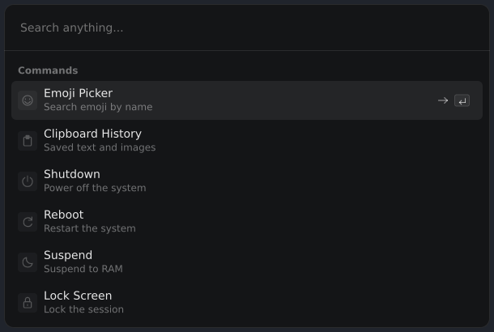
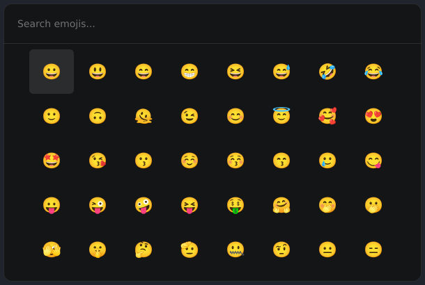
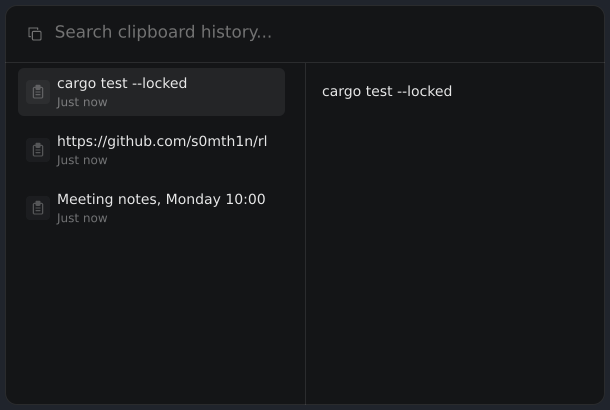

# rl

A small Wayland launcher for applications, emoji and clipboard history. It draws
on the CPU, needs no GPU toolkit and runs as a daemon you toggle with a key.



## Features

- Application search from XDG desktop entries, with fuzzy matching and icons.
- Emoji picker with name and shortcode search (`:`).
- Text and PNG clipboard history (`;`), stored locally. Copies marked as
  password-manager content are skipped.
- Calculator, system actions, web search (`!g`, `!d`, `!wiki`, `!yt`, or your own providers).
- Window switching on Hyprland, KWin, Niri and MangoWM.
- Optional transparency and compositor blur.






## Usage

Start the daemon once from your compositor config, then bind a key to `rl toggle`.

```sh
rl                    # run the daemon
rl toggle             # show or hide the panel
rl show -m emojis     # open straight into a mode
rl reload
rl --help
```

Modes: combined, applications, emojis, calculator, clipboard, actions, search,
windows. Combine them with commas.

Type to search. Up/Down or Tab/Shift-Tab select, Enter activates, Escape clears
the view and then closes the panel. `:` opens emoji, `;` opens clipboard history.

Compositor autostart and key binding examples:

```kdl
// niri
spawn-at-startup "rl"
binds { Mod+Space { spawn "rl" "toggle"; } }
```

```
# sway
exec rl
bindsym Mod4+space exec rl toggle
```

```
# hyprland
exec-once = rl
bind = SUPER, SPACE, exec, rl toggle
```

## Installation

You need a Wayland compositor with wlr-layer-shell. Clipboard history also needs
wlr-data-control (`wl-copy` from wl-clipboard is the fallback for copying).

### From source

Build dependencies: Rust 1.91 or newer, a C linker, pkg-config, libxkbcommon.
Runtime: fontconfig and a sans-serif font; Noto Color Emoji for colour emoji;
`xdg-utils` for web search.

```sh
git clone https://github.com/s0mth1n/rl
cd rl
cargo build --release --locked
```

### Install script

```sh
./install.sh                 # build, then install to ~/.local
./install.sh --systemd       # also install the user service
./install.sh --prefix /usr/local
./install.sh --uninstall
```

The script checks build tools, fontconfig, text and bitmap colour emoji fonts,
wl-clipboard, xdg-utils and basic command-line tools. It offers to install packages
with apt (Debian/Ubuntu), dnf (Fedora/RHEL derivatives), pacman (Arch), zypper
(openSUSE), apk (Alpine), xbps (Void) or emerge (Gentoo). Package availability
varies by release and enabled repositories. It does not add repositories: RHEL
may need EPEL/CRB; Alpine needs its matching community repository.

Like the NiriMod installer, it detects your distribution, shows the dependency
step and asks before installing packages. `--yes` approves package installation
as well as the initial confirmation. `--skip-deps` skips package installation,
not the checks. Rust/Cargo must meet the minimum in Cargo.toml; installing or
updating Rust with rustup always needs a separate confirmation, even with
`--yes`. The build runs as the invoking user, never through sudo.

NixOS should use the flake below. Atomic/immutable systems are detected and the
script does not change their host packages. Prepare dependencies in the image
or build in a matching development container. On a minimal Alpine installation,
install Bash first (`apk add bash`), then run `bash install.sh`. Alpine also
needs `libxkbcommon-static` for the musl Rust target; the installer includes it.

Fedora's Noto package uses COLRv1, which rl does not render. When the selected
emoji font is unsupported, the script separately offers a pinned, SHA-256-checked
upstream bitmap font and its OFL license in your user fonts. It does not replace
system fonts or change global fontconfig rules. A small rl wrapper selects the
bitmap file for rl only; your `EMOJI_FONT` override wins. This download prompt is
not skipped by `--yes`. Uninstall keeps this font with the other dependencies.

The script refreshes the font cache, checks font selection, links a C test program,
builds the locked release, and runs the installed binary's `--version` and `--help`.
It needs a working network for package, Rust and Cargo downloads. It does not
install or configure your compositor, terminal, browser or session manager.
Set `TERMINAL` to your terminal executable if you do not use xterm. Built-in
power/session actions need systemd/logind; they are not portable to OpenRC or
runit. Do not install systemd just for this launcher.

A prefix you cannot write to needs a separate sudo confirmation. `--systemd`
installs the user unit and offers to activate it interactively; `--yes` leaves it
disabled. Use only one autostart method. Uninstall keeps config, history, shared
packages and Rust. Remove the user unit with `--uninstall --systemd` if installed.

### Nix

```sh
nix run github:s0mth1n/rl
nix profile install github:s0mth1n/rl
nix develop            # dev shell
```

With the overlay (`overlays.default`) the package is `pkgs.rl`.

NixOS:

```nix
{
  inputs.rl.url = "github:s0mth1n/rl";
  # in your configuration
  imports = [ inputs.rl.nixosModules.default ];
  programs.rl.enable = true;
}
```

Home Manager:

```nix
{
  imports = [ inputs.rl.homeManagerModules.default ];
  programs.rl = {
    enable = true;
    systemd.enable = true;
    settings = {
      enable_transparency = true;
    };
  };
}
```

## Configuration

`~/.config/rl/config.toml`, read at startup. Restart the daemon after editing.

```toml
launcher_size = [600.0, 400.0]
enable_backdrop = true
enable_transparency = true
max_clipboard_history = 500
store_passwords = false
```

Fonts, web search providers, privacy notes and blur are in
[docs/configuration.md](docs/configuration.md).

## Compositors

| Compositor | Panel | Windows mode | Notes |
| --- | --- | --- | --- |
| sway | yes | no | |
| niri | yes | yes | Blur needs niri git main (26.04+), see docs/configuration.md |
| labwc | yes | no | |
| river | yes | no | |
| cosmic-comp | yes | no | |
| Wayfire | yes | no | Set `enable_backdrop = false`; the default backdrop does not render yet |
| Hyprland | untested here | yes | `hyprland_auto_blur` sets blur rules |
| KWin | untested here | yes | |
| MangoWM | untested here | yes | |

"yes" means checked in a nested session of that compositor. Hyprland, KWin and
MangoWM need a GPU render node that the test machine did not have, so the
panel was not run there.


The launcher, search, emoji and clipboard screenshots are from a private
headless sway session. The blur and window screenshots are older nested niri
captures with a `background-effect` layer rule.

## Development

See [docs/development.md](docs/development.md). Changes are listed in
[CHANGELOG.md](CHANGELOG.md).

## License

MIT, see [LICENSE](LICENSE). Parts of the layout and behaviour come from
third-party code (MIT), see [NOTICE](NOTICE).
