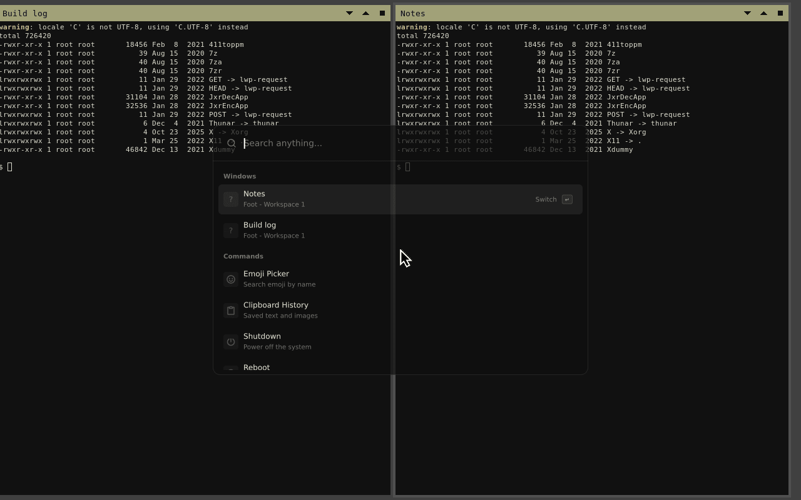
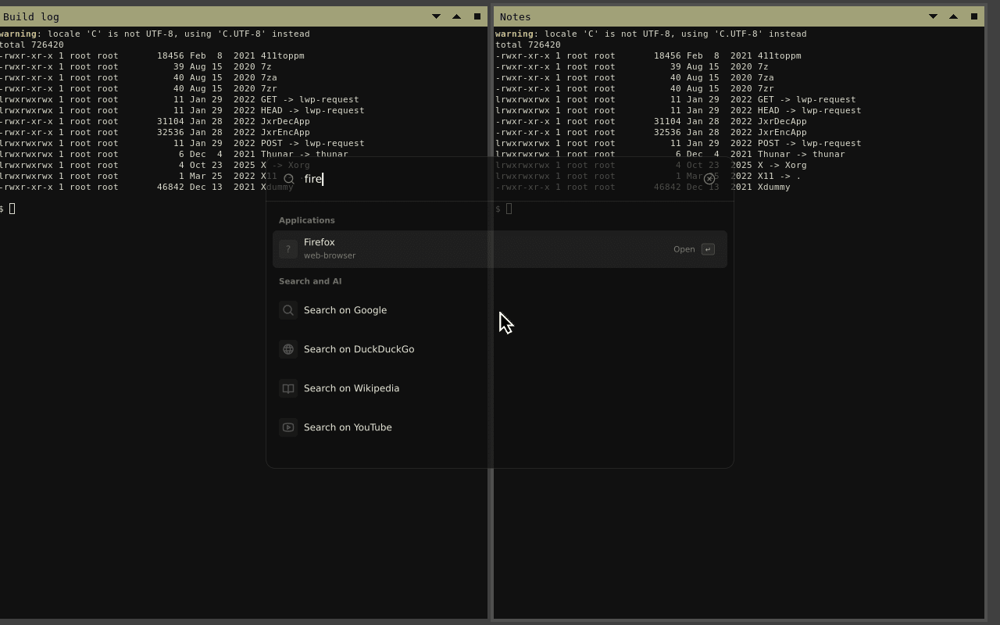
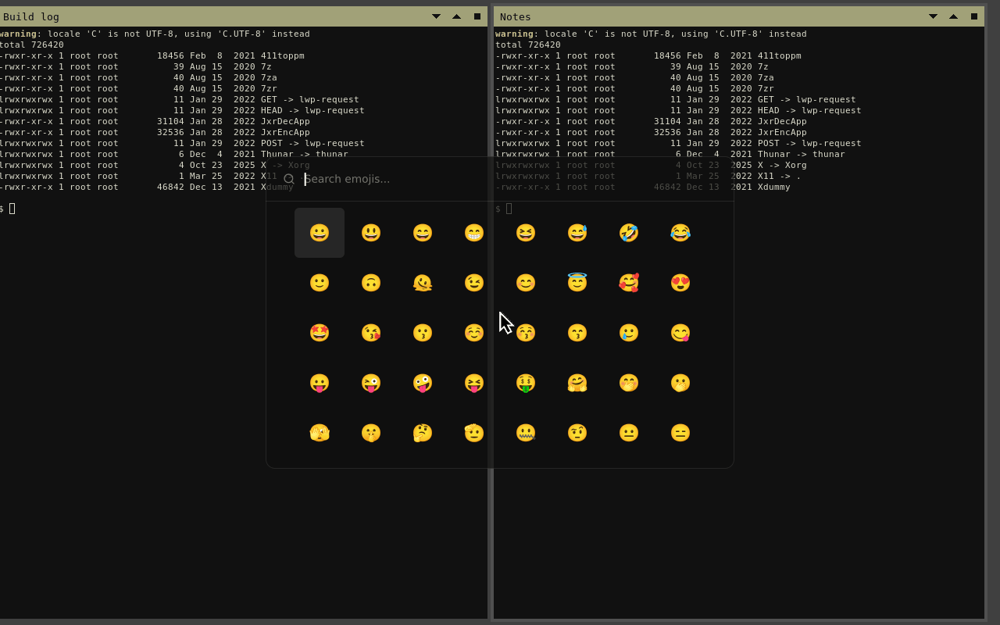
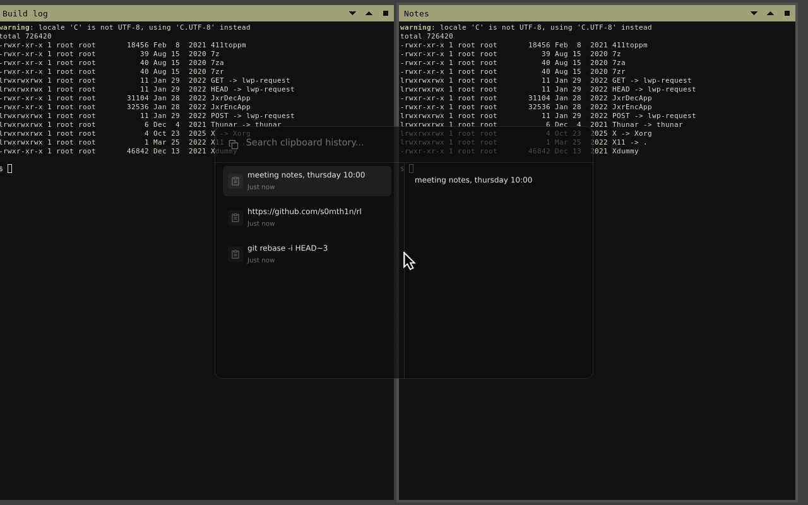
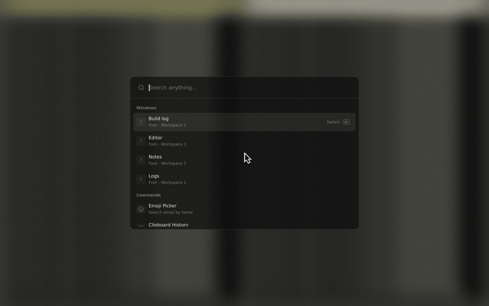
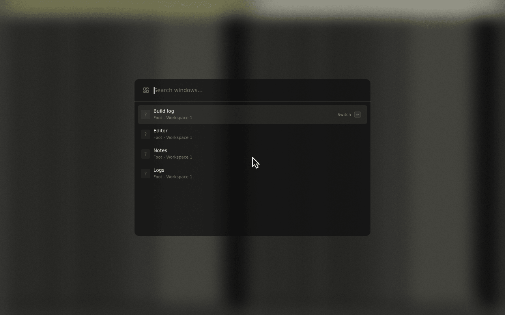

# zl

A small Wayland launcher for applications, emoji and clipboard history. It draws
on the CPU, needs no GPU toolkit and runs as a daemon you toggle with a key.
The layout and behaviour follow [zlaunch](https://github.com/zortax/zlaunch).



## Features

- Application search from XDG desktop entries, with fuzzy matching and icons.
- Emoji picker with name and shortcode search (`:`).
- Text and PNG clipboard history (`;`), stored locally. Copies marked as
  password-manager content are skipped.
- Calculator, system actions, web search (`!g`, `!d`, `!wiki`, `!yt`, or your own providers).
- Window switching on Hyprland, KWin, Niri and MangoWM.
- Themes, live preview, optional transparency and compositor blur.







## Usage

Start the daemon once from your compositor config, then bind a key to `zl toggle`.

```sh
zl                    # run the daemon
zl toggle             # show or hide the panel
zl show -m emojis     # open straight into a mode
zl theme list
zl theme set NAME
zl reload
zl --help
```

Modes: combined, applications, emojis, calculator, clipboard, actions, search,
themes and windows. Combine them with commas.

Type to search. Up/Down or Tab/Shift-Tab select, Enter activates, Escape clears
the view and then closes the panel. `:` opens emoji, `;` opens clipboard history.

Compositor autostart and key binding examples:

```kdl
// niri
spawn-at-startup "zl"
binds { Mod+Space { spawn "zl" "toggle"; } }
```

```
# sway
exec zl
bindsym Mod4+space exec zl toggle
```

```
# hyprland
exec-once = zl
bind = SUPER, SPACE, exec, zl toggle
```

## Installation

You need a Wayland compositor with wlr-layer-shell. Clipboard history also needs
wlr-data-control (`wl-copy` from wl-clipboard is the fallback for copying).

### From source

Build dependencies: Rust 1.91 or newer, a C linker, pkg-config, libxkbcommon.
Runtime: fontconfig and a sans-serif font; Noto Color Emoji for colour emoji;
`xdg-utils` for web search.

```sh
git clone https://github.com/s0mth1n/rl
cd rl
cargo build --release --locked
```

### Install script

```sh
./install.sh                 # build, then install to ~/.local
./install.sh --systemd       # also install the user service
./install.sh --prefix /usr/local
./install.sh --uninstall
```

The script builds with cargo as your user. It asks before using sudo, and only
for a prefix you cannot write to. It never enables the service for you:

```sh
systemctl --user enable --now zl.service
```

### Nix

```sh
nix run github:s0mth1n/rl
nix profile install github:s0mth1n/rl
nix develop            # dev shell
```

With the overlay (`overlays.default`) the package is `pkgs.zl`.

NixOS:

```nix
{
  inputs.zl.url = "github:s0mth1n/rl";
  # in your configuration
  imports = [ inputs.zl.nixosModules.default ];
  programs.zl.enable = true;
}
```

Home Manager:

```nix
{
  imports = [ inputs.zl.homeManagerModules.default ];
  programs.zl = {
    enable = true;
    systemd.enable = true;
    settings = {
      theme = "default";
      enable_transparency = true;
    };
  };
}
```

## Configuration

`~/.config/zl/config.toml`, read at startup. Restart the daemon after editing.

```toml
theme = "default"
launcher_size = [600.0, 400.0]
enable_backdrop = true
enable_transparency = true
max_clipboard_history = 500
store_passwords = false
```

Themes, fonts, web search providers, privacy notes and blur are in
[docs/configuration.md](docs/configuration.md).

## Compositors

| Compositor | Panel | Windows mode | Notes |
| --- | --- | --- | --- |
| sway | yes | no | |
| niri | yes | yes | Blur needs niri git main (26.04+), see docs/configuration.md |
| labwc | yes | no | |
| river | yes | no | |
| cosmic-comp | yes | no | |
| Wayfire | yes | no | Set `enable_backdrop = false`; the default backdrop does not render yet |
| Hyprland | untested here | yes | `hyprland_auto_blur` sets blur rules |
| KWin | untested here | yes | |
| MangoWM | untested here | yes | |

"yes" means checked in a nested session of that compositor. Hyprland, KWin and
MangoWM need a GPU render node that the test machine did not have, so the
panel was not run there.





The screenshots come from a nested niri build with a `background-effect` layer
rule. `tests/screenshots.sh` regenerates them.

## Development

See [docs/development.md](docs/development.md). Changes are listed in
[CHANGELOG.md](CHANGELOG.md).

## License

MIT, see [LICENSE](LICENSE). Parts of the layout, themes and behaviour come from
zlaunch (MIT), see [NOTICE](NOTICE).
